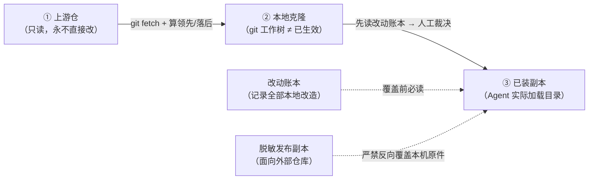

# skill-change-workflow

**改一个 skill 之前，先看这套流程。** 它把「上游仓 → 本地克隆 → 已装副本」三层之间的关系讲清楚，给出三条铁律和五个动作，并说明**覆盖之前必须先读什么**。

> **A workflow to check before you change any agent skill** — the three layers (upstream repo → local clone → installed copy), three hard rules, five steps, and what you must read before overwriting anything.

**它是斜杠专用的**：装好之后**不会自动触发**，必须显式调用（见下方「怎么用」）。
**It is slash-only**: it will not trigger by itself. You must invoke it explicitly.

- 许可证 / License: **MIT**（见 `LICENSE`）
- 本次改动 / Changes: 见 `CHANGELOG.md`

---

## 中文

### 它解决什么问题

你大概遇到过这三种情况：

1. 改了 agent 里的某个 skill，**下次更新一到，改动没了**，而且不报错；
2. 上游仓、本地克隆、agent 实际加载的目录**三份文件长得一样，但你不知道哪一份在生效**；
3. 把一份「发给别人看」的版本**装回了自己机器**，本机那份从此少了路径和内部引用。

这三种都是**静默失败**：不报错、不中断，几周后才发现。这个 skill 就是防这三件事的。

### 一张图看懂三层通道（与防覆盖边界）



> **v1.1.0 路径区分**：需长期跟进上游的 skill 库走完整三层；一次性使用的外部单件 skill 在人点名确认后可直接下载检查并装入已装目录，避免堆积无用克隆与 Fork。

### 适不适合你

| 适合 | 不适合 |
|---|---|
| 你维护一个 skill 库，并且它有「上游 → 本地 → 已装」不止一层 | 你只有一个目录，手写 skill、自己用 |
| 你会改别人仓里的 skill，还要跟上游更新 | 你只想问「这个任务该用哪个 skill」 |
| 你需要记住「我到底改过什么」，防止被覆盖 | 你要写 skill 正文（那要找写作规范类的 skill） |

### 5 分钟装上

**第 1 步 · 克隆到你的 agent 的 skills 目录**

```bash
git clone https://github.com/cyanxjh/skill-change-workflow.git "<你的 skills 目录>/skill-change-workflow"
```

`<你的 skills 目录>` 是哪个？两条已实测的：

| Agent | 目录 |
|---|---|
| Claude Code | `~/.claude/skills/` |
| pi | `~/.pi/agent/skills/`（或 `~/.agents/skills/`） |

其他 agent 请查它自己的文档——**不同 agent 的目录不共享**，装错地方不会报错，只会「看起来装了但没生效」。

**第 2 步 · 确认它真的在那里**

```bash
ls "<你的 skills 目录>/skill-change-workflow"
```

应当看到 `SKILL.md`、`LICENSE`、`README.md` 等文件。**只看「克隆命令没报错」不算装上。**

**第 3 步 · 调用它**

| Agent | 怎么调 |
|---|---|
| Claude Code | `/skill-change-workflow` |
| pi | `/skill:skill-change-workflow` |

**第 4 步 · 你应当看到什么**

它会先反问你一件事：**你这次改的是「有上游仓的东西」还是「自己刚写的全新件」**——因为两者的路径不同。

然后它给出判断：三层里你要动的是哪一层、有没有分叉（领先/落后）、需不需要人来裁决。

> 如果你看到的是「这个 skill 不适用于当前情况」并退出——**那是对的**，说明你的场景不在它管的范围内。

**第 5 步 · 跑完自查**

它的正文末尾有四个自检问题，逐个答一遍。答不上来的，就是这次没做完的部分。

### 它不会做什么

- **不会替你装东西**：它是流程说明，不是安装器。
- **不会替你决定内容取舍**：三条铁律里有一条就是「不说不动」。
- **不会真的执行 git 命令**：它给命令，由你执行。
- **不联网、不收集数据、不含任何密钥。**

### 这个仓库的结构

```
skill-change-workflow/
├── SKILL.md              ← 流程本体（agent 读的就是它）
├── README.md             ← 你正在读的这份
├── LICENSE               ← MIT
├── CONTRIBUTING.md       ← 提 issue / PR 前请看
├── SECURITY.md           ← 安全边界与私密报告方式
├── CODE_OF_CONDUCT.md    ← 参与约定
├── CHANGELOG.md          ← 改了什么
└── .gitignore
```

**注意**：`SKILL.md` 必须在**仓库根目录**，这样 `git clone` 下来的目录名就是 skill 名，安装才是一条命令。

### 参与

见 `CONTRIBUTING.md`。安全问题请走私密渠道，见 `SECURITY.md`。

---

## English

### What it solves

Three silent failures:

1. You change a skill inside your agent; the next update **wipes your change** — no error, nothing in the logs.
2. You have an upstream repo, a local clone, and the directory your agent actually loads. **They look identical; you can't tell which one is live.**
3. You install a **sanitised public copy** back into your own machine, and your local copy loses its real paths and internal references.

This skill is a checklist for those three.

> **v1.1.0 path distinction**: Use the full 3-layer workflow for skill libraries you track long-term; for one-off standalone skills from external repos, install directly after human approval and safety checks instead of accumulating unused local clones or forks.

### Is it for you?

**Yes** if you maintain a skill library with more than one layer (upstream → local → installed), or you edit skills from someone else's repo and follow upstream updates.

**No** if you only have a single folder of self-written skills, or you just want to know which skill to use for a task.

### Install in 5 minutes

```bash
git clone https://github.com/cyanxjh/skill-change-workflow.git "<your skills dir>/skill-change-workflow"
```

Where is `<your skills dir>`? Two verified cases: Claude Code uses `~/.claude/skills/`; pi uses `~/.pi/agent/skills/` (or `~/.agents/skills/`). For other agents, check their docs — **directories are not shared between agents**, and installing into the wrong one fails silently.

Verify it is really there:

```bash
ls "<your skills dir>/skill-change-workflow"
```

Invoke it explicitly — **it is slash-only and will not trigger on its own**:

| Agent | Invocation |
|---|---|
| Claude Code | `/skill-change-workflow` |
| pi | `/skill:skill-change-workflow` |

**What you should see**: it first asks whether you are changing something *with* an upstream repo or a brand-new skill you just wrote — the two paths differ. Then it tells you which layer you are touching, whether the branches have diverged, and whether a human decision is needed.

If it says "this skill does not apply here" and exits, that is correct behaviour.

### What it does not do

It is not an installer, it does not decide content trade-offs for you, and it does not run git commands on your behalf. It makes no network calls and contains no secrets.

### Layout

`SKILL.md` sits at the **repository root**, so `git clone` produces a directory whose name equals the skill name — that is what makes installing a single command.

### Contributing / Security

See `CONTRIBUTING.md` and `SECURITY.md`. Security reports should be private.

---

## License

MIT © 2026 cyanxjh
